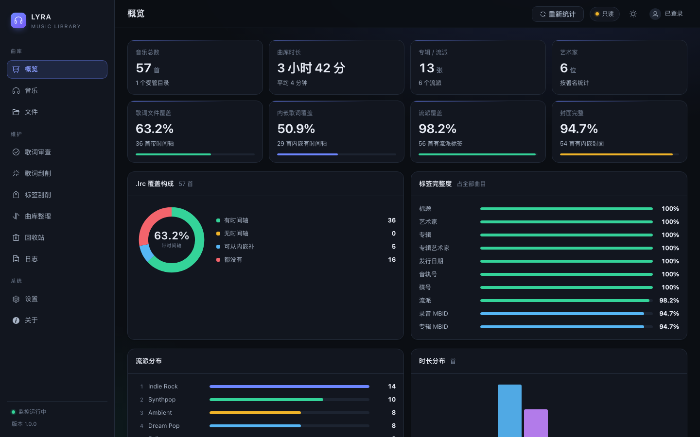
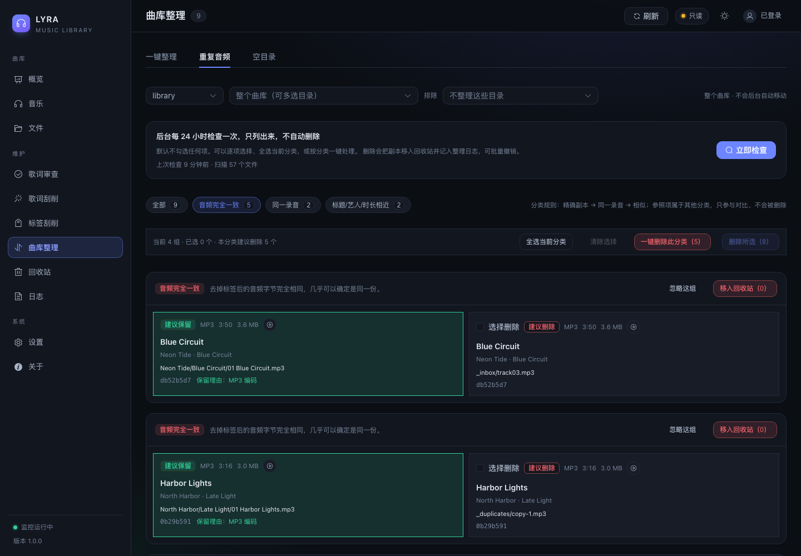

# Lyra

[](https://github.com/astralwaveorg/lyra/actions/workflows/ci.yml)
[](https://github.com/astralwaveorg/lyra/releases)
[](LICENSE)
[](https://github.com/astralwaveorg/lyra/pkgs/container/lyra)
[](https://www.python.org/)

Lyra is a self-hosted maintenance tool for a local music library. It fills in lyrics and tags, organizes folders by metadata, detects duplicate audio, and records every write, move, and deletion so it can be reviewed and undone.

It is built for libraries that already live on a NAS or local disk, mostly FLAC, MP3, and OGG, with inconsistent tags and lyrics. Lyra binds to localhost by default and treats every file operation as something that must be previewed, backed up, and reversible.





## Features

**Lyrics**

- Recursive library scan for FLAC, MP3, OGG Vorbis, and Opus.
- Fetches from QQ Music, NetEase Cloud Music, and LRCLIB, scored by title, artist, album, duration, and version.
- Writes embedded lyrics and a matching `.lrc`; creates `.lrc` from embedded lyrics when missing.
- Skips valid synced lyrics; handles plain text, placeholders, and broken timelines separately.
- Review page with line-by-line comparison, source switching, bulk accept, and undo.

**Tags**

- MusicBrainz is the primary source, using the public API by default or a self-hosted mirror.
- Lookup by MBID, folder consensus, title search, and AcoustID fingerprint fallback.
- Per-field preview: fill, correct, conflict, or same.
- Conflict fields are checked by default; select all or clear all in one click; confirmation before writing.
- Background scans fill only missing fields. Conflicts are never overwritten automatically.
- Only target fields are rewritten. Audio data, cover art, lyrics, and unknown tags are preserved.

**Library organization**

- Generates `Artist / Album / Track# - Title` paths, with multi-artist, compilation, multi-disc, and missing-field handling.
- Multi-select include folders and multi-select exclusions. Never moves files in the background.
- Every move is previewed with old and new paths. Existing targets are never overwritten.
- `.lrc` files follow audio renames; emptied directories can be cleaned up.
- Duplicate detection is split into exact audio, same recording, and similar title/artist/duration.
- Filter by category, select a whole category, or delete a whole category. References and files in other categories are never deleted with it.
- Deletion moves files to a trash folder, never unlinks them. Single items and batches can be undone.

**Auditability**

- Full backup before writing, plus original values for every changed field.
- Organize operations record old path, new path, trash path, and batch.
- Logs are grouped by writes, renames, and organize operations, with multi-select batch undo.
- Crash recovery checks actual file hashes instead of trusting database state.

## Quick start

Requires Docker 24+ and Docker Compose v2.

```bash
git clone https://github.com/astralwaveorg/lyra.git
cd lyra

cp .env.example .env
mkdir -p config data
cp deploy/lyra.container.toml.example config/lyra.toml
```

Set the music path in `.env`:

```dotenv
LIBRARY_HOST_PATH=/path/to/your/music
```

Start the stack:

```bash
docker compose up -d --build
```

`--build` builds from this checkout. To use the published image instead, run `docker compose pull` and then `docker compose up -d`.

Open `http://127.0.0.1:8080`. On first start Lyra creates the `admin` account and writes a random password to `data/initial-password.txt`:

```bash
cat data/initial-password.txt
```

Change it after logging in, or set `LYRA_ADMIN_PASSWORD` in `.env` before the first start.

Put a reverse proxy in front of the port for HTTPS. See [deployment](docs/deployment.md) (Chinese).

## Configuration

Configuration is layered, lowest to highest priority:

1. built-in defaults
2. `lyra.toml`
3. `LYRA_*` environment variables

Common variables:

| Variable | Purpose |
| --- | --- |
| `LIBRARY_HOST_PATH` | Host path to the music library, used by Compose |
| `LYRA_CONFIG` | Config file path, default `/config/lyra.toml` in the image |
| `LYRA_LIBRARY_ROOT` | Container path to the library, default `/music` |
| `LYRA_DATA_DIR` | Data directory, default `/data` |
| `LYRA_WEB_BIND` | Bind address, default `127.0.0.1` |
| `LYRA_WEB_PORT` | Port, default `8080` |
| `LYRA_ADMIN_USERNAME` | Admin username, default `admin` |
| `LYRA_ADMIN_PASSWORD` | Admin password; random on first start when empty |
| `LYRA_ACOUSTID_API_KEY` | Optional AcoustID key |
| `LYRA_AI_API_KEY` | Optional key for AI-assisted review |

Full reference: [configuration](docs/configuration.md) (Chinese). Deployment and troubleshooting are also documented under [`docs/`](docs/index.md).

## Safety

- Binds to loopback by default; put HTTPS in front.
- One admin account, scrypt password hashing. Session cookies for the Web UI, Bearer tokens for scripts and mobile clients.
- Credentials come from environment variables or a 0600 config file. They are not logged or rendered.
- Backups before writes; audio hash and non-target tags are verified after writes.
- Moves are previewed and recorded. Targets are never overwritten. Deletions go to trash.
- Duplicate detection is read-only. It never deletes files automatically.
- With `policy.write_enabled = false`, every write endpoint refuses to run.

Report vulnerabilities through [GitHub Security Advisories](https://github.com/astralwaveorg/lyra/security/advisories/new), not a public issue. See [SECURITY.md](SECURITY.md).

## Formats

| Format | Read | Lyrics | Tags | Cover |
| --- | --- | --- | --- | --- |
| FLAC | yes | yes | yes | yes |
| MP3 | yes | yes | yes | yes |
| OGG Vorbis | yes | yes | yes | no |
| Opus | yes | yes | yes | no |

Writes are byte-level edits rather than a full `mutagen.save()` rewrite. The audio hash is compared before and after; a mismatch triggers a rollback.

## Development

```bash
python3 -m venv .venv
./.venv/bin/pip install -e ".[dev]"

cd web
npm ci
npm run build
cd ..

./.venv/bin/lyra config init
./.venv/bin/lyra config check
./.venv/bin/python -m pytest -q
```

For frontend development:

```bash
cd web
npm run dev      # http://127.0.0.1:5273, /api proxied to 8080
```

See [CONTRIBUTING.md](CONTRIBUTING.md) and [development](docs/development.md).

## Community and sponsorship

- Issues: [GitHub Issues](https://github.com/astralwaveorg/lyra/issues)
- Chat group: [sponsor and community](docs/sponsor.md)
- Donations are optional and do not unlock any feature.

Stars, issues, pull requests, documentation fixes, and deployment notes are all welcome.

## License

MIT License, copyright Lyra contributors. See [LICENSE](LICENSE).
